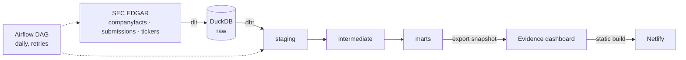

# Corporate Credit Risk Monitor

[](https://github.com/vanshbhatia0303-hash/corporate-credit-risk-monitor/actions/workflows/ci.yml)

**Which public REITs are drifting toward covenant stress, before a rating downgrade shows it?**

An end-to-end data pipeline that turns SEC EDGAR XBRL filings into an early-warning dashboard: it tracks leverage (Debt/EBITDA) and interest coverage over each company's last eight reported quarters, for 50 US-listed REITs across 12 sub-sectors.

**Live dashboard: https://corporate-credit-risk-monitor.netlify.app**


## What you get

- A **stress score and rank** for every company, based on how fast leverage is rising and coverage is falling.
- A **risk level** (High / Elevated / Moderate) from the latest absolute values, so a slow drift at a safe level is not confused with real danger.
- **Filters** by sub-sector, trend, data status and minimum score, plus a per-company history drill-down.
- A **data-freshness view** showing which companies have filed a 10-Q that SEC has not yet published as structured data, and which are not ranked and why.

## Architecture



| Layer | Tool | Why |
|---|---|---|
| Extraction | dlt | Schema inference, retries, idempotent `merge` loads |
| Warehouse | DuckDB | Zero-ops columnar engine, fits the data volume |
| Transform | dbt-core | Layered SQL models with tests and lineage |
| Orchestration | Airflow (Astro CLI, Docker) | Scheduled runs, retries, a single-run guard |
| BI | Evidence | SQL + markdown dashboards built as a static site |
| Hosting | Netlify | Free static hosting with deploy-on-push |
| Containers | Docker Compose | Reproducible dashboard preview and Airflow stack |

## Repository layout

```
ingestion/      dlt source and pipeline (SEC EDGAR -> DuckDB raw)
dbt_project/    staging, intermediate and marts models, plus tests
airflow/        Astro project and the daily DAG
scripts/        export of the marts into the dashboard's DuckDB snapshot
evidence/       the dashboard (pages, source definition, snapshot)
docker-compose.yml, netlify.toml
```

## How to run it

Prerequisites: Python 3.12+, Docker, and a descriptive SEC User-Agent (SEC requires a name and contact email).

```bash
git clone https://github.com/vanshbhatia0303-hash/corporate-credit-risk-monitor.git
cd corporate-credit-risk-monitor
python -m venv .venv && source .venv/bin/activate   # Windows: .\.venv\Scripts\Activate.ps1
pip install -r requirements.txt

export SEC_USER_AGENT="Your Name you@example.com"
export WAREHOUSE_PATH="$PWD/warehouse.duckdb"
python ingestion/pipeline.py                         # extract + load (about 30 seconds)

cd dbt_project && export DBT_PROFILES_DIR=$PWD && dbt build && cd ..
python scripts/export_snapshot.py                    # marts -> dashboard snapshot
docker compose up evidence                           # dashboard at http://localhost:3000
```

Run it on a schedule with Airflow:

```bash
cd airflow && cp .env.example .env    # set SEC_USER_AGENT
astro dev start                       # UI at the URL printed (port may vary)
```

## How the numbers are built

1. **Raw:** SEC `companyfacts` (XBRL line items), `submissions` (filing history) and the ticker map, loaded with `merge` on a composite key so reruns never duplicate.
2. **Staging:** types cast, and restatements deduplicated by keeping the latest filed value per company, concept and period.
3. **Intermediate:**
   - Discrete quarters are derived from year-to-date facts (Q2 = 6M - 3M, Q3 = 9M - 6M, Q4 = FY - 9M), because filings never report Q4 alone.
   - Each metric has a tag fallback chain, since issuers tag the same thing differently.
   - **Total debt** is the largest of the candidate debt tags, because a component can never exceed its total. It is rejected if under 3% of assets.
   - **EBITDA** is derived (XBRL has none) from operating income + D&A, falling back to pre-tax or net income + interest + D&A. All methods add back impairments, and the income-based methods remove property-sale gains, in the spirit of Nareit's EBITDAre.
4. **Marts:** trailing-four-quarter Debt/EBITDA and interest coverage per company-quarter, then an 8-quarter trend per company. The **stress score** is the average percentile rank of the leverage slope and the (inverted) coverage slope.

## Data quality

27 blocking dbt tests (keys, not-null, relationships, accepted values, grain) and four warn-level monitors that surface known data limits without failing the build:

- **Ratio bounds:** flags implausible leverage or coverage values.
- **Debt plausibility:** flags missing or implausibly large debt.
- **Debt method stability:** flags companies whose debt tag switches inside the trend window.
- **Freshness vs filings:** compares SEC's filing history with the facts API to find filers whose newer 10-Q has not been published as structured data.

**CI:** GitHub Actions runs `dbt run` and `dbt test` on every pull request against a small committed fixture of raw data for six companies (`ci/raw_fixture.duckdb`). It proves the SQL and tests are correct, not that live SEC data is fresh; that is the Airflow freshness monitor's job.

## Engineering notes: problems found and fixed

- **Silent staleness in SEC's API.** A dozen filers had a filed Q2 10-Q whose XBRL facts were missing from `companyfacts`. Comparing it with the `submissions` endpoint proved the filings existed. The monitor now labels this as "awaiting SEC data" instead of showing stale ratios as current.
- **Tag-priority bugs in debt.** A "first matching tag" chain picked a $0.04B component as total debt for a $25B borrower, and a negative-valued tag produced negative debt. The fix was taking the largest candidate, rejecting negatives, and adding plausibility tests.
- **A 160x leverage artifact.** A net-income-based EBITDA turned real-estate impairments (about $2.2B at one issuer) into a fake leverage spike. Adding back impairments and removing property-sale gains brought it to about 6x and fixed a second issuer (149x to 4x).
- **Corporate actions.** Tickers change and companies merge (two residential REITs merged during the project, and one ticker was renamed). Tickers are resolved at runtime and exclusions are documented rather than hidden.
- **A quiet deployment failure.** The Netlify build succeeded while publishing an empty dataset, because the template's `.gitignore` excluded the data-source definition. The fix was tracking `connection.yaml`.
- **Locked-down Windows.** An OS application-control policy blocked native binaries, so the dashboard runs inside Docker. Peer-dependency conflicts were pinned explicitly in `package.json`.

## The honest tradeoff

This monitor measures **public-filing proxies, not covenants.** Real covenant definitions (for example, how a credit agreement defines EBITDA) live in loan documents, not in XBRL. The metrics here are leading indicators built from reported numbers, and they are only as good as the derivations behind them.

Other known limitations:

- **EBITDA is derived.** Impairment and gain tags are not reported consistently, so some one-offs can survive the adjustment.
- **The dashboard is a snapshot,** not a live query. Refreshing means re-running the pipeline, exporting, and redeploying.
- **Evidence legacy.** The static-site generator is now labelled "legacy" by its maintainers. Their newer product (Evidence Studio) queries a live database server-side, so it cannot be hosted on Netlify's static hosting.
- **DuckDB is single-writer,** so the DAG runs one at a time (`max_active_runs=1`).
- **Not investment advice.**

## Roadmap

- Alerting on failed runs and on new freshness gaps.
- A port of the same pipeline to Microsoft Fabric (Lakehouse and Warehouse, Data Factory, Power BI).

## License

MIT